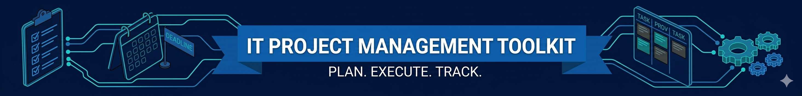

# IT Project Management Toolkit & Templates 📋

## Professional project management templates and artifacts designed for IT and GameDev professionals, Project Managers, and aspiring specialists building their portfolios.
---
## ✨ What's Included
1. [**01-Initiation**](./01-Initiation) - Proposal, Project Charters and Stakeholder Registers.🌟🌿
2. [**02-Planning**](./02-Planning) - RACI Charts, Project Plans, and Communication Strategies.🔥
3. [**03-Execution**](./03-Execution) - Status Reports, Risk Logs, and ROAM Analysis.👾
4. [**04-Closing**](./04-Closing) - Retrospectives and Project Closeout Reports.🏆
5. [**05-Portfolio Artifacts**](./05-Portfolio) - **End-to-End Implementation:** See the full lifecycle of the "Plant Pals" project implementation.💎
6. [**06-Game Development**](https://github.com/Valeriia458/IT-Project-Management-Toolkit-Templates/tree/main/06-Game%20Development) - Main documentation for Game Development🎮
## 🎯 Who Is This For?
- Aspiring and Junior Project Managers
- IT and GameDev professionals transitioning into Project Management
- Game Designers, Developers, and other GameDev team members
- Professionals looking for practical project management resources
- Anyone building a Project Management portfolio
## 🚀 Quick Start
Copy the necessary template from my Google Drive to yours

## 👩🏻‍💻 Resources
[WordLayouts](https://www.wordlayouts.com/)  
[Coursera](https://www.coursera.org/)  
[Miro](https://miro.com/index/)  
[Cacoo](https://nulab.com/cacoo/)   
[TeamRetro](https://www.teamretro.com/)  
[Project Management Docs](https://www.projectmanagementdocs.com/)  
[Atlassian](https://www.atlassian.com/project-management/templates)  
[Smartsheet](https://www.smartsheet.com/content/project-management-plan-templates)  
[Airtable](https://www.airtable.com/templates/project-management/expnPwND0WA2x7nhJ) 

## 📚📚 Project Management Books

[Herding Cats: A Primer for Programmers Who Lead Programmers
by J. Hank Rainwater, 2002](https://drive.google.com/file/d/1QMz9CT6QLwCn2kRkE2CNePH5bg5SOjZK/view?usp=sharing)

## 📰📰 Articles
  

## ✨ Why this Toolkit?
* **End-to-End Implementation:** Includes a full implementation as a reference point.
* **Standardized:** Based on the industry-leading Google PM Professional Certificate methodology.
* **IT Focused:** Optimized for IT and software development workflows.

## 📄 License
MIT - Free to use!

## 🤝 Contributing

Contributions are welcome! Whether you'd like to suggest a new template, improve an existing one, report an issue, or share an idea, your input is appreciated.
Please read our [Contributing Guidelines](CONTRIBUTING.md) to learn how to get involved.
Let's make project management easier and more accessible together!

## ⭐ How to support
If you find these templates helpful for your PM journey, please **give this repository a star!** It helps other aspiring PMs find these resources and supports my professional growth.

## 👩🏻‍💻 About the Author
I am an aspiring Project Manager focused on the IT and GameDev industries. 
* [**My LinkedIn**](https://www.linkedin.com/in/valeriia-bovsunovska-aa8615312/)

